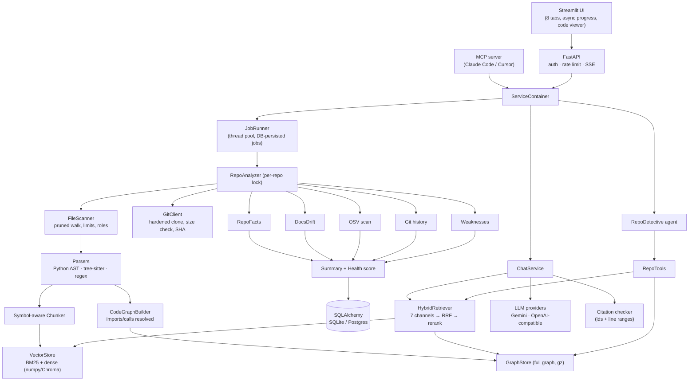

# RepoMind: Current State

**22 October 2026 implementation update:** The audit's ten reproduced defects now have regression coverage. Analysis uses per-run mutable components and immutable staged snapshots, with pinned reads and historical redacted sources. Citation checks require fully visible line ranges; confidence labels describe retrieval relevance, not semantic support. Partial scans, failed parses and unknown dependency checks are exposed, the UI shows full static findings, and the CLI supports local analysis and SARIF export. See [evals/README.md](evals/README.md) for the external draft corpus and controlled ablations. The older snapshot description below predates these changes; its benchmark “recall” headline means Hit@k. Independent labels, held-out answer-quality assessment and developer studies are still outstanding.

**Snapshot date:** 2026-10-02 · **Version:** 0.2.0 · **Status:** a working single-node prototype with production-minded hardening (API-key auth, rate limiting, structured errors, migrations, non-root Docker image). It is not production-hardened: jobs, rate limiting and caches are in-process, and the evaluation is a small dev set (§8, §11). 100+ offline tests pass, lint is clean, and migrations match the models.

This document describes what RepoMind is, how every part works, what was changed in the 0.2 overhaul and why, how it was verified, and what remains. It is the reference for anyone working on the project.

---

## 1. What RepoMind is

RepoMind takes a public GitHub repository URL and produces:

1. **A structured analysis:** purpose, tech stack, entrypoints, central modules, run instructions, architecture diagrams, and a traceable 0–100 health score.
2. **Grounded answers** to natural-language questions, with citations (`[S1]` → `path:start-end`) whose source ids and line ranges are **checked** against the evidence actually retrieved (claim-level support is not verified), plus an evidence-strength signal; RepoMind abstains when the repo lacks strong evidence.
3. **A Repo Detective agent** that investigates multi-hop questions ("how does POST /orders reach the payment provider?") by searching, reading code and following the call graph.
4. **Risk insights:** docs-vs-code drift, known-vulnerable dependencies with reachability, git churn hotspots, complex and dead code, import cycles, and static security findings.

Design principles, from [AGENTS.md](AGENTS.md):
- **Deterministic first.** Every feature works offline without an LLM, and LLMs are optional enhancers.
- **Evidence over eloquence.** Every chunk keeps repo id, path, role, language, line range and symbol, and answers separate cited evidence from uncertainty.
- **Graceful degradation, never silent failure.** Missing optional dependencies, providers or network access fall back to a local path and log why.

---

## 2. Architecture



### 2.1 Analysis pipeline (`RepoAnalyzer.analyze`)

| # | Stage | Module | Output |
|---|---|---|---|
| 1 | fetching | [git_client.py](app/ingestion/git_client.py) | Clone (depth `GIT_HISTORY_DEPTH`) or refresh (`force`), commit SHA |
| 2 | scanning | [scanner.py](app/ingestion/scanner.py) | `FileRecord[]` + scan stats (pruned walk, byte/file caps, UTF-8-safe truncation) |
| 3 | parsing | [multilang_parser.py](app/parsing/multilang_parser.py), [python_parser.py](app/parsing/python_parser.py) | Entities (qualified), import details, calls, routes, env vars, entrypoints |
| 4 | chunking | [chunker.py](app/parsing/chunker.py) | Symbol-bounded chunks with contextual headers (`path › Class.method`) |
| 5 | indexing | [vector_store.py](app/rag/vector_store.py) | Chunk sidecar + BM25 + dense vectors, manifest with embedder id |
| 6 | graph | [code_graph.py](app/graph/code_graph.py), [resolver.py](app/graph/resolver.py), [graph_store.py](app/graph/graph_store.py) | Full graph persisted; bounded summary for the API; PageRank, cycles, complexity |
| 7 | facts | [repo_facts.py](app/analysis/repo_facts.py) | Run instructions, docs, entrypoints, frameworks (from dependencies), important files |
| 8 | history | [history.py](app/analysis/history.py) | Hotspots, contributors, bus factor |
| 9 | dependencies | [dependencies.py](app/analysis/dependencies.py) | Pinned inventory, OSV vulnerabilities, reachability, unpinned list |
| 10 | drift | [drift.py](app/analysis/drift.py) | Docs-vs-code issues + docs accuracy |
| 11 | weaknesses | [weaknesses.py](app/analysis/weaknesses.py) | Repo-scoped findings (static + graph + drift + CVE) |
| 12 | summary | [summary.py](app/analysis/summary.py), [quality.py](app/analysis/quality.py) | Summary JSON, insights, health score |
| 13 | saving | [repository.py](app/db/repository.py) | DB rows (or JSON fallback) |

Each stage reports progress through a callback that the job runner persists, so the UI and the SSE stream see live stage and percentage. When the file, byte or chunk caps (`MAX_FILES_PER_REPO`, `MAX_TOTAL_REPO_BYTES`, `MAX_CHUNKS_PER_REPO`) truncate a repo, the analysis reports partial coverage instead of implying it saw everything. Cached analyses of small repos load in about 20 ms. The cache is only valid when the metadata, a **compatible** vector index (same embedder and format) and the full graph all exist; otherwise RepoMind rebuilds automatically.

### 2.2 Question answering (`ChatService.answer`)

1. **Query understanding:** word-boundary intent patterns ([retriever.py](app/rag/retriever.py)) plus identifier extraction (`snake_case`, `CamelCase`, dotted, backticked). Follow-up questions are rewritten using the previous user turn.
2. **Candidate channels:**
   - `dense`: embedding similarity (numpy matmul or Chroma). With the default `EMBEDDING_PROVIDER=local` this is a **lexical** feature-hashing embedder, not a neural model (§7)
   - `lexical`: BM25 over code-aware tokens (identifier sub-words plus light stemming)
   - `symbol`: exact symbol-table hits, mapped to their line ranges
   - `mentioned`: files named in the question
   - `priority`: intent-specific files (install docs for run questions, entrypoints for architecture, and so on)
   - `facts`: line ranges the deterministic extractor already tied to the intent (for example, the exact README sections containing run commands)
   - `graph`: 1-hop neighbours of the top seed files
3. **Fusion:** weighted Reciprocal Rank Fusion ([fusion.py](app/rag/fusion.py)), with weights chosen per intent.
4. **Rerank:** a hand-weighted local feature reranker (coverage, identifier/symbol/path hits, role priors) by default, or an optional general-purpose cross-encoder ([rerank.py](app/rag/rerank.py)).
5. **Diversify:** at most 3 chunks per file, and overlapping ranges are dropped.
6. **Generate:**
   - With an LLM, the system prompt is kept separate from the data. Sources are wrapped in `<source id path lines>` tags, untrusted repo text is escaped inside those blocks so it cannot close them, and a character budget is applied ([grounding.py](app/rag/grounding.py)).
   - Without one, intent-specific deterministic answers are used (run, weakness, code/call-flow, files, architecture, overview).
   - Answers report evidence strength, and RepoMind abstains instead of answering when the repo lacks strong evidence.
7. **Check citations:** every `[S#]` id and `path:line` range is checked against the retrieved evidence. Ones that don't match are marked `⚠unverified`. A grounding score (`0.6 × citation precision + 0.4 × share of claim-like lines that carry a citation`) is returned. This is a structural check: it does not verify that a cited span supports the sentence.
8. **Cache:** an LRU keyed by (repo, commit, normalized question, recent history, provider).

### 2.3 Repo Detective (`/repo/{id}/investigate`)

[tools.py](app/agent/tools.py) exposes read-only tools: `search_code`, `grep`, `read_file`, `find_symbol`, `callers`, `callees`, `call_path`, `file_neighbors`, `list_files`. `grep` is a literal search by default; regex mode is opt-in and bounded.
- **With an LLM**, [detective.py](app/agent/detective.py) runs a provider-agnostic JSON action protocol for up to 10 steps, so it works with Gemini, OpenAI or Ollama without native function calling. The final answer's `path:line` citations are checked against the lines the tools actually returned.
- **Without an LLM**, a deterministic plan runs: locate symbols, read their definitions, then callers and callees, a call path when two symbols are given, and hybrid search. The response includes the step trace and the evidence list.

---

## 3. Module map

```
app/
  config.py            Settings (read from env at construction, not import)
  models.py            FileRecord, Chunk (header/index_text), CodeEntity (qualname), Weakness, AnalysisResult
  main.py              FastAPI app, lifespan, exception handlers, /health, /ready
  mcp_server.py        MCP server (SDK v2 MCPServer, v1 FastMCP fallback)
  api/
    routes.py          All endpoints; repo_id validated by regex on every route
    services.py        ServiceContainer (lazy, overridable), JobRunner, error→code mapping
    security.py        X-API-Key auth (constant-time), per-client rate limiting
  core/
    repo_analyzer.py   Pipeline orchestration, per-repo locks, read_file, delete (safe_join)
    chat.py            ChatService (retrieve → answer → check citations → cache)
    interfaces.py      EmbeddingProvider, VectorStoreBackend, SourceParser, LLMProvider
  ingestion/           git_client.py, scanner.py
  parsing/             python_parser.py, multilang_parser.py, chunker.py
  graph/               code_graph.py, resolver.py, graph_store.py (GraphStore + GraphIndex queries)
  rag/                 tokenize.py, embeddings.py, bm25.py, vector_store.py, fusion.py, rerank.py,
                       retriever.py, llm.py, grounding.py
  agent/               tools.py, detective.py
  analysis/            repo_facts.py, weaknesses.py, drift.py, dependencies.py, history.py, quality.py, summary.py
  db/                  models.py (single schema source), repository.py (DB + JSON fallback, jobs)
  ui/streamlit_app.py  Streamlit UI
  utils/               paths.py (URL/repo-id validation, safe_join), redaction.py (secrets), logging.py
evals/                 fixture_repo.py (ShopAPI benchmark repo + gold questions), run_eval.py
migrations/            Alembic 0001 initial, 0002 jobs + commit_sha
tests/                 100+ tests (offline; optional backends auto-skip)
```

---

## 4. API surface

See the table in [README.md](README.md#api). Behaviour worth knowing:
- `repo_id` must match `^[a-z0-9_][a-z0-9_.-]{0,200}-[0-9a-f]{10}$`, so traversal values like `..` get a 422 before any handler runs.
- Errors are structured as `{"detail": {"code", "message"}}` with codes such as `invalid_input`, `repo_not_found`, `repo_too_large`, `clone_failed`, `clone_timeout`, `index_stale` (409) and `internal_error` (500, with a log reference id). Unexpected exceptions never return raw text; input-validation errors (`invalid_input`, `repo_too_large`) do return their own app-generated message.
- A chat response contains `answer`, `citations[]` (id, path, lines, symbol, redacted excerpt, `cited`), `llm` (provider, model, latency, token usage, or the reason it wasn't used), `grounding` and `intents`. With `debug: true` it also returns the retrieval trace showing each chunk's rank in each channel.
- Jobs persist in the `analysis_jobs` table. Jobs left running by a crashed process are marked `interrupted` on startup.

---

## 5. Configuration

All settings live in [.env.example](.env.example), grouped by LLM, retrieval, storage, ingestion limits, network-backed analysis and API. The most important ones:

| Variable | Default | Notes |
|---|---|---|
| `LLM_PROVIDER` | `auto` | `auto` uses Gemini when a key is set, otherwise an OpenAI-compatible endpoint if configured. `off` disables LLM calls. |
| `OPENAI_BASE_URL` / `OPENAI_MODEL` | OpenAI / empty | Point at `http://localhost:11434/v1` for local Ollama |
| `EMBEDDING_PROVIDER` | `local` (lexical hashing) | `sentence-transformers` or `auto` for semantic vectors (needs advanced extras; falls back to hashing with a warning if unavailable). Changing it invalidates indexes automatically. |
| `VECTOR_STORE_PROVIDER` | `local` | `chroma` for a Chroma dense backend (advanced extras). BM25 and chunk data are always local. |
| `RERANKER_PROVIDER` | `local` | `cross-encoder` requires sentence-transformers |
| `MAX_REPO_SIZE_MB` | `1024` | Enforced on disk while cloning; the GitHub API size pre-check is advisory |
| `GITHUB_TOKEN` | empty | Optional; only raises the GitHub API rate limit for the size pre-check. Never passed to git |
| `TRUSTED_PROXIES` | empty | Comma-separated proxy IPs/CIDRs whose `X-Forwarded-For` is trusted for rate limiting; empty ignores the header |
| `EVIDENCE_MIN_COVERAGE` | `0.6` | Share of question terms one top chunk must cover to count as strong evidence |
| `EVIDENCE_RERANK_THRESHOLD` | `0.5` | Cross-encoder relevance that alone counts as strong evidence; below the floors, answers abstain |
| `COLLAPSE_DUPLICATE_FILES` | `true` | Index one copy of byte-identical files |
| `METADATA_DB_FALLBACK` | `auto` | `auto`: JSON fallback only for the implicit SQLite file, fail fast when `DATABASE_URL` is set; `true`/`false` force it |
| `OSV_SCAN_ENABLED` / `GITHUB_API_CHECKS_ENABLED` | `true` | Set both to `false` for air-gapped runs |
| `REPOMIND_API_KEY` | empty | Enables API-key auth (the UI reads the same variable) |
| `GIT_HISTORY_DEPTH` | `50` | Clone depth, and therefore the size of the history window |

---

## 6. Data layout

```
data/
  repos/<repo_id>/                 git clones (hooks disabled, no credential helpers)
  indexes/<repo_id>.chunks.json    chunk sidecar + manifest {format, embedding_model, dense_backend}
  indexes/<repo_id>.npy            dense vectors (numpy backend)
  indexes/chroma/                  Chroma collections (chroma backend)
  graphs/<repo_id>.json.gz         full code graph (node-link JSON)
  metadata/                        JSON fallback when the DB is unavailable
  db/repomind.db                   SQLite (when DATABASE_URL is unset)
```

`repo_id` = `<owner>-<repo>-<sha1(normalized lowercase URL)[:10]>`. Clones created by older versions (mixed-case hash) are migrated automatically, but **only** when the clone's own `origin` URL normalizes to the requested repository. Existing `data/` from v0.1 needs no manual steps: old indexes fail the format check and are rebuilt on the next analysis.

---

## 7. AI/ML design notes

- **Embeddings.** The default is an offline, code-aware signed feature-hashing embedder (`local-hashing-v3-512`). It is **lexical, not semantic**, so the default "dense" channel overlaps heavily with BM25; it is fused with BM25, symbol and graph channels rather than used alone. Semantic recall needs `requirements-advanced.txt` plus `EMBEDDING_PROVIDER=sentence-transformers`. The default semantic model (`all-MiniLM-L6-v2`) and cross-encoder (`ms-marco-MiniLM-L-6-v2`, trained on web passages) are general-purpose, not code-tuned, and are used without query/document prefixes. The index manifest keeps mismatched embedders from ever being mixed.
- **Chunking.** Chunks follow symbol boundaries from AST or tree-sitter entities. Small definitions become one chunk; large containers are split into a header chunk plus one chunk per member; anything still too long is windowed with overlap. No line is dropped and nested definitions are never duplicated. Every chunk carries a header (`path › class Foo`) that is embedded and indexed with it.
- **Graph.** Import resolution handles Python absolute, relative and `from x import y` forms (including src-layout), JS/TS relative, index and `@/` imports, and Java/Go/Rust/C path conventions. Call resolution uses `self`/`this` methods, same-file definitions, imported symbols, and module aliases, and falls back to a repo-unique name marked low confidence. Symbols are stored with qualified names.
- **Grounding.**
  - *Prompt injection:* the system and data channels are separated, sources are tagged as untrusted, and repo text is escaped inside source blocks so it cannot close them. This reduces, but does not eliminate, injection risk.
  - *Secrets:* they are redacted before any text reaches an LLM, the UI or the logs.
  - *Citations:* every citation id and line range the model writes is checked afterwards against the retrieved evidence, not just requested in the prompt. Claim-level support (does the span back the sentence?) is not checked yet (roadmap).
  - *Abstention:* answers carry an evidence-strength signal and abstain when the repo lacks strong evidence, instead of always answering from the top-k chunks.
- **Cost and latency.** Queries on small repos take about 20–60 ms without an LLM (the index is cached in memory by mtime). The LLM receives at most 8 sources within a 14k-character budget. The UI makes no automatic LLM calls, and repeated questions are answered from the cache.

---

## 8. Evaluation

`python -m evals.run_eval` builds the ShopAPI fixture: a synthetic Python API with 9 modules, a TS frontend, docs, env files and tests. It then asks 20 gold-labelled questions (written by the same author as the fixture) of three systems and scores **file-level** retrieval. The eval always uses the default hashing embedder, so `dense_only` is a lexical baseline:

| system | recall@1 | recall@3 | recall@5 | MRR |
|---|---|---|---|---|
| dense_only | 0.850 | 0.900 | 1.000 | 0.892 |
| bm25_only | 0.800 | 1.000 | 1.000 | 0.892 |
| **repomind_hybrid** | **1.000** | **1.000** | **1.000** | **1.000** |

Hybrid symbol-level recall@5 is 0.941. The benchmark runs in CI, and [test_eval_harness.py](tests/test_eval_harness.py) enforces a regression gate.

**Caveats:**
- The fixture was also used to tune the intent weights, stemming and reranker, so these are **dev-set** numbers. Treat them as a regression guard, not a generalization claim.
- n=20 cannot resolve differences smaller than roughly 15–20 points, and a perfect score cannot show further improvement.
- "Hybrid beats dense" here means lexical-plus-heuristics beats lexical; it does not compare against a neural embedder.
- Nothing about answer quality, faithfulness or abstention is measured.

**Optional semantic models.** CI's advanced job also runs the same 20 questions with `all-MiniLM-L6-v2` embeddings and the `ms-marco-MiniLM-L-6-v2` cross-encoder. One local run on 2026-10-02 gave `dense_only` R@1 0.800 / MRR 0.883 and hybrid R@1 0.900 / MRR 0.950 (symbol recall@5 1.000). On this fixture the general-purpose models do **not** beat the tuned lexical defaults, so code-tuned models need a real eval before becoming the default.

The next step is a held-out set of pinned real repositories, with unanswerable questions to test abstention (§12).

On a real repository, an earlier version of RepoMind itself (71 files, 334 chunks), a full analysis took 1.6 s including the clone. The graph had 531 nodes and 1,081 edges, with 244 resolved calls and 111 instantiations. It detected FastAPI, Streamlit, SQLAlchemy, Pydantic, PyTorch and Docker. Run questions retrieved the README Setup, Run Backend and Run Frontend sections first.

---

## 9. What changed in 0.2 (review item → fix)

### 🔴 Critical defects (all were reproduced before fixing; all now have regression tests)

| ID | Defect | Fix | Test |
|---|---|---|---|
| C1 | `DELETE /repo/%2E%2E` → `rmtree(data/)` | Regex-validated `repo_id` on every route; `validate_repo_id` + `safe_join` in the analyzer and git client | `test_api.py::test_delete_rejects_path_traversal…`, `test_repo_analyzer.py::test_delete_refuses_invalid_ids` |
| C2 | Gemini key in URL leaked through exception text to the API, DB and UI | `x-goog-api-key` header; coded `LLMError` with user-safe messages; `scrub()` on all logged details | `test_llm.py::test_network_errors_never_expose_the_api_key`, `test_chat_service.py::…without_leaking_details` |
| C3 | Weakness IDs not repo-scoped, so a second repo's save failed (your DB held 1 of 5 analyses) | IDs hash the repo id; the DB key is `<repo_id>:<id>`; the save path deletes explicitly by repo | `test_metadata_repository.py::test_two_repos_with_identical_findings_both_save` |
| C4 | Prefix-glob cache made `facebook/react` return `react-native` | Glob removed; legacy migration only after verifying the clone's origin URL | `test_git_client.py` |
| C5 | Chroma results all had `id=""`, so merge kept one chunk | IDs returned from Chroma; cosine space; hash-safe collection names | `test_vector_store.py::test_chroma_backend_returns_distinct_ids` (real Chroma) |
| C6 | Index/embedder mismatch went undetected (both 384-dim) | Manifest check on `exists`/`load`; `IndexStaleError` → 409 → auto-rebuild on analyze | `test_vector_store.py::test_index_built_with_other_embedder…` |
| — | `force=True` never refreshed code | `git fetch --depth N origin HEAD` + `reset --hard` | — |
| — | Concurrent analyses of the same repo raced | Per-repo locks; one active job per repo | `test_api.py::test_async_analysis_job…` |

### 🟠 Major improvements

- **Retrieval rewrite:** covers the multi-channel fusion and ranking of §2.2, the code-aware tokenizer with stemming, and word-boundary intents (the old substring match sent "truncate" to run-instructions and "latest" to testing).
- **Chunking:** fixed duplicated nested methods, JS functions truncated at 80 lines, and whole files lost at a UTF-8 truncation boundary.
- **Graph:** Python local imports went from 0 edges to fully resolved; calls went from unresolved to resolved (callers, callees, call paths); node-ID collisions fixed with qualified names; full graph persisted instead of the first 500 nodes.
- **LLM layer:**
  - A provider interface with Gemini and any OpenAI-compatible endpoint.
  - Retries with backoff on 429/5xx, stale-model fallback, safety-block handling and token usage reporting.
  - The prompt no longer anchors on the templated answer.
- **Heuristics:**
  - AST-based security checks, so `model.eval()`, `literal_eval` and `retrieval(` are no longer "HIGH eval" findings.
  - Frameworks detected from declared or imported dependencies rather than substrings (no more Next.js/Express false positives).
  - Path-segment test detection, so `latest.py` is no longer a test.
  - Overfit repo-specific strings removed.
  - Secret detection needs quoted or env-style values and rejects placeholder and sequential fakes.
- **Persistence:**
  - One schema source ([db/models.py](app/db/models.py)) used by both the app and Alembic.
  - Migration 0002 added, and drift against the models was verified to be zero.
  - Chat and summary loads no longer pull every chunk.
  - Jobs are persisted.
- **API and ops:**
  - Async jobs with SSE progress, `/ready` diagnostics, API-key auth and rate limiting.
  - Structured errors, lifespan-managed services, and no import-time side effects in routes.
  - Noisy HTTP loggers are silenced so URLs never reach the logs.
- **UI:** async analysis with a live progress bar; the repo picker; Insights and Detective tabs; an interactive file graph; grounding badges; a code viewer that opens citations. The Run tab no longer calls the LLM on every load.
- **Infra:**
  - CI has three jobs: (1) lint, tests with `pytest-cov` coverage, and the benchmark; (2) an `advanced` job (slow; CPU-only PyTorch, pip and Hugging Face caches) that installs `requirements-advanced.txt`, runs the suite with the optional backends, and smoke-tests the semantic embedder and cross-encoder end to end, failing if either silently falls back; (3) a `docker build` with an import smoke check.
  - Non-root Docker image with a healthcheck, containing runtime dependencies only (no pytest/httpx).
  - Compose file with api, ui and postgres, bound to localhost with the password taken from `.env`.
  - Separate requirements files: `requirements.txt` (runtime), `requirements-dev.txt` (runtime + pytest, pytest-cov, httpx2, ruff), `requirements-advanced.txt` (optional extras).

### 🚀 New capabilities
Repo Detective agent · docs-drift detector · OSV dependency scan with reachability · git hotspots and bus factor · health score from measured signals · MCP server · retrieval benchmark.

---

## 10. Verification performed for this snapshot

The live-server and Streamlit checks below were performed for the 0.2 overhaul; the test and benchmark figures are re-run as the code changes.

- `ruff check .`: clean.
- `pytest`: 100+ passed, including the real Chroma backend, tree-sitter parsing and MCP tool registration when those extras are installed (they auto-skip otherwise). The test suite pins the local embedder and reranker; the semantic paths are exercised by CI's advanced job (§9).
- `alembic upgrade head` on a fresh SQLite database, then `compare_metadata`: no drift.
- **Live server:**
  - `/ready` reports its configuration correctly.
  - `DELETE /repo/%2E%2E` returns 422.
  - A stale index returns 409 with rebuild guidance.
  - An async job streams SSE `progress` then `completed` events.
- **Streamlit, driven headlessly (`AppTest`) against the live backend:** all 8 tabs render; chat, Detective and citation Open work with zero exceptions.
- **End-to-end analysis of a real cloned repository:** covered in §8.

---

## 11. Known limitations and honest caveats

- **Benchmark scope:** 20 self-written questions on a single fixture repo that doubles as the tuning set (§8). There's no held-out real-repo evaluation yet, and no LLM-answer faithfulness evaluation (the citation checker covers structure, not truth).
- **Default embeddings are lexical.** Semantic recall needs `requirements-advanced.txt` and `EMBEDDING_PROVIDER=sentence-transformers`; the bundled model choices are general-purpose, not code-tuned. CI smoke-tests these paths, but there are no unit tests for them and their quality is unmeasured beyond the fixture.
- **Optional extras.** Tree-sitter parsing for non-Python languages, semantic embeddings, the cross-encoder, Chroma and the MCP server all require `requirements-advanced.txt` (the Docker image includes tree-sitter only). Without tree-sitter, non-Python files fall back to regex parsing; even with it, non-Python parsing is a shallow, language-agnostic walk (no complexity metrics).
- **Size caps truncate.** Large repos can hit `MAX_FILES_PER_REPO`, `MAX_TOTAL_REPO_BYTES` or `MAX_CHUNKS_PER_REPO`; the chunk cap keeps whole files in role order (docs, code, config, tests, then shallower paths first), so deep code and tests are the first to be dropped. The analysis reports partial coverage when this happens, but those files are not searchable.
- **Static call graph:** dynamic dispatch, dependency injection, callbacks and reflection are not resolved. Name-only fallback edges are marked `confidence: low`, and roughly 2,000 calls per mid-size repo stay unresolved (mostly stdlib and third-party).
- **Single node:** the job runner is an in-process thread pool (jobs are persisted, but work does not survive a restart), and the rate limiter and answer cache are per process. Multi-worker deployments need Redis-backed equivalents.
- **Drift detector:** it checks commands only inside fenced shell blocks and top-level or `docs/` markdown. Commands prefixed with `cd …` are skipped.
- **OSV** checks only pinned versions (`==` or lockfiles); ranges like `requests>=2` are listed as unpinned rather than resolved. Reachability is at import level, not function level.
- **History** is limited to `GIT_HISTORY_DEPTH` commits (default clones are shallow).
- **Detective with an LLM** uses a JSON protocol rather than native tool calling, so weaker models may need more steps.
- The UI's Mermaid and vis-network rendering loads from the jsDelivr CDN.

---

## 12. Roadmap (next steps, prioritized)

1. **Held-out evaluation.** Pin 5–10 real repos (`repo@sha`) with about 100 gold Q&A pairs; add LLM-judged faithfulness and citation precision; report per-intent metrics in CI.
2. **Postgres + pgvector** as the single store for chunks, vectors (`tsvector` for BM25), graph edges and jobs, removing the file sidecars in server deployments.
3. **Redis-backed** job queue (arq/RQ), rate limiter and answer cache for multi-worker scale; streaming LLM answers over SSE.
4. **"Does it actually run?" sandbox:** execute the extracted install and run commands in an ephemeral container and mark instructions as verified.
5. **Auto-fix PRs:** generate patches for findings (CI, `.gitignore`, tests for central untested modules, dependency bumps to OSV fixed versions) and validate them in the sandbox.
6. **PR impact bot** (GitHub App): use the call graph to report a diff's blast radius (affected routes, tests and owners).
7. **Function-level CVE reachability** by combining advisory symbols with the call graph.
8. Incremental re-indexing by diffing file SHA-256 between commits.

---

## 13. How to run and develop

```bash
python3 -m venv .venv && source .venv/bin/activate
pip install -r requirements-dev.txt          # add requirements-advanced.txt for tree-sitter/Chroma/semantic/MCP
cp .env.example .env
bash scripts/run_backend.sh                  # API :8000
bash scripts/run_frontend.sh                 # UI  :8501
bash scripts/run_mcp.sh                      # MCP over stdio

ruff check . && python -m pytest -q          # 100+ tests, fully offline
python -m pytest --cov=app                   # with coverage (pytest-cov)
python -m evals.run_eval                     # retrieval benchmark table
alembic upgrade head                         # DB migrations
docker compose up --build                    # postgres + api + ui (set POSTGRES_PASSWORD in .env)
```

Testing conventions: tests never use the network or your `.env` keys ([tests/conftest.py](tests/conftest.py) isolates both). Use temp directories and the ShopAPI fixture (`shop_env`). Optional backends are tested with `pytest.importorskip`.
